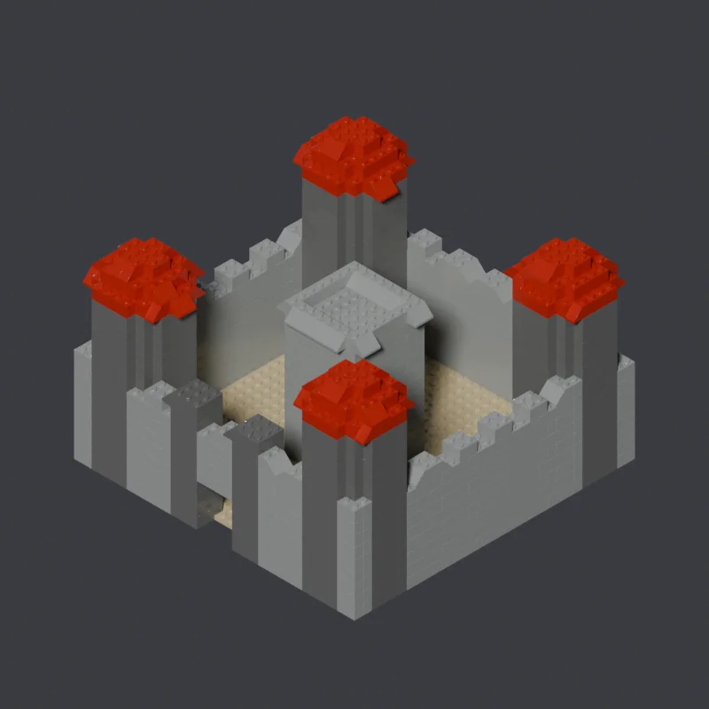
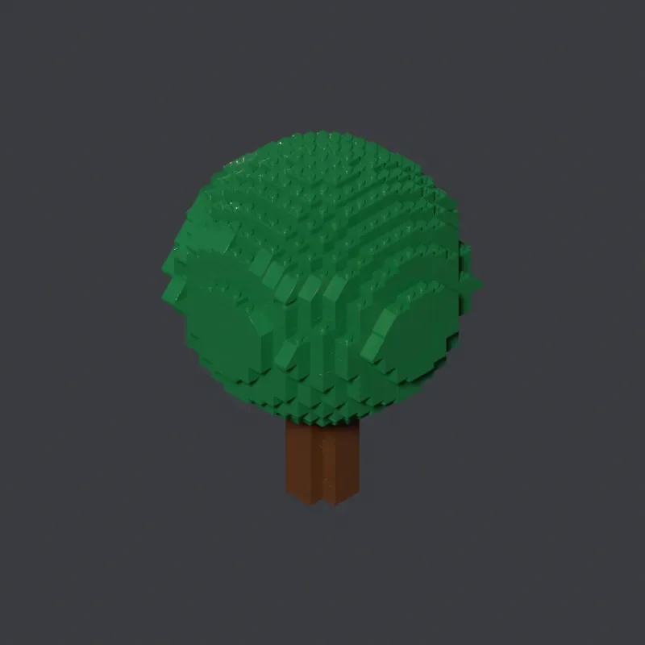
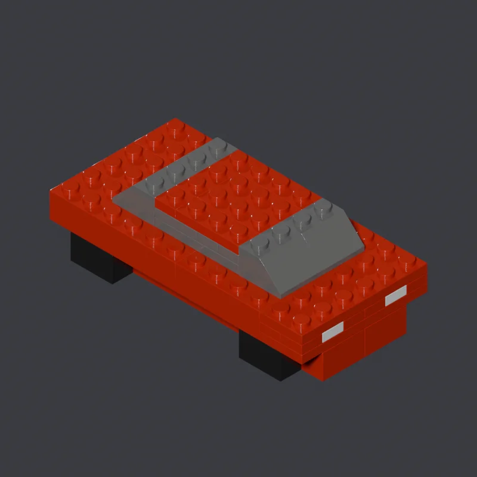
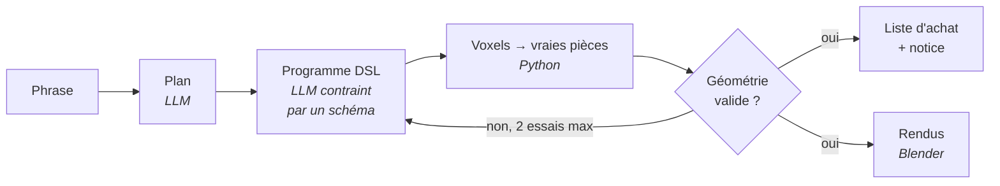

# LLMtoL — des modèles LEGO en vraies pièces, depuis une phrase

<p align="center">
  
  <br>
  <em>« Un grand château de chevalier, avec des tours rondes, des créneaux, un donjon central et une porte » → 1 232 pièces</em>
</p>

On décrit un objet en français. LLMtoL produit un modèle LEGO **constructible**, fait de vraies pièces du catalogue LDraw, avec sa liste d'achat, sa notice de montage et ses rendus Blender. Le modèle de langage tourne **en local** (LM Studio).

## Exemples

| | | |
|:-:|:-:|:-:|
|  |  |  |
| « un grand château de chevalier… » | « un arbre : un tronc cylindrique… et un feuillage sphérique… » | « une voiture rouge, avec des roues, un pare-brise… » |
| 1 232 pièces | 1 153 pièces | 39 pièces |

## Comment ça marche

Le LLM ne pose **jamais** les briques lui-même : il est mauvais pour garantir qu'une pièce tient, mais bon pour imaginer une forme. Il écrit donc un plan, puis un petit programme d'opérations volumétriques. Tout le reste est du code Python déterministe.



Une interface web (FastAPI, PostgreSQL, Vue) permet de proposer plusieurs variantes pour une même phrase et de garder la meilleure.

## Résultats mesurés

| | avant | après |
|---|:-:|:-:|
| Formes simples (cube, pavé, cylindre), IoU | 0,82 | **1,00** |
| Générations posées hors sol | 9/26 | **0/26** |
| Créatures d'un seul tenant | 0/15 | **12/14** |

Protocole et chiffres complets : [docs/mesures.md](docs/mesures.md).

## Limites actuelles

Avec un modèle local, les résultats restent inégaux dès que la demande se complique : les formes simples et les bâtiments s'en sortent bien, le reste est moins fiable. Les pistes : brancher un modèle distant (clé API ou serveur MCP), ou fine-tuner le modèle local.

## Démarrer

Prérequis : Python 3.11+, [LM Studio](https://lmstudio.ai) (serveur sur `localhost:1234`), Blender, la bibliothèque [LDraw](https://www.ldraw.org) et l'add-on ImportLDraw.

```powershell
pip install -r requirements.txt
python tools/check_env.py      # vérifie l'environnement, sans rien modifier

python lego.py "Un phare blanc avec une lanterne rouge au sommet."
python lego.py "Une petite maison" --taille petite --iterations 3
```

Chaque génération est écrite dans un dossier horodaté de `outputs/`.

## Qualité

```powershell
pip install -r requirements-dev.txt
python -m ruff check .
python -m pytest tests/ -q     # 341 tests
```

## Documentation

- [docs/guide-complet.md](docs/guide-complet.md) : pipeline détaillée, pile web, DSL, notice, évaluation.
- [docs/flux_donnees.md](docs/flux_donnees.md) : types exacts et exemples réels à chaque étape.
- [docs/mesures.md](docs/mesures.md) : toutes les mesures, avec leur protocole.

## Licence

Code sous licence MIT (voir [LICENSE](LICENSE)). La bibliothèque LDraw n'est pas incluse : elle reste sous sa propre licence.
